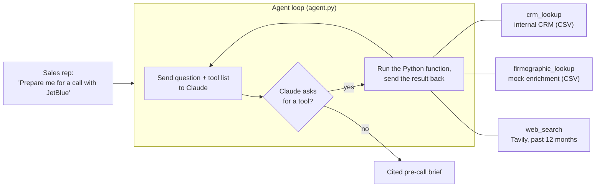

# Account Research Agent

An AI agent that prepares a B2B sales rep for a call. Give it a company name and it pulls the
CRM record, third-party company data and recent public news, then writes a **cited pre-call
brief**: deal snapshot, company context, recent signals, risks and talking points. Every fact
links to its source, and gaps or conflicts in the data are flagged instead of filled in.

Built in Python with the Anthropic SDK and a hand-written tool-use loop (no agent framework),
then evaluated with a written rubric on a fixed test set and improved over two scored iterations.

> **Data note:** company names are real so that web search finds genuine news, but **all CRM
> and firmographic data in `data/` is fictional**, for a made-up password-security vendor. Two
> companies (Harborline Freight Co., Mesa Verde Dental Group) are entirely invented to test
> failure handling.

---

## What a brief looks like

Excerpt from `briefs/after_fix2/JetBlue.md` (full brief in the repo):

```text
## 3. Recent signals
1. JetBlue CISO Keith Anderson departed for Travelers; he had held the "VP, Technology
   Infrastructure & Chief Information Security Officer" title at JetBlue [3]
...
## 4. Risks and open questions
- Champion status is unclear/conflicting in CRM notes — must confirm who the current
  Director of IT Security is before the call [1]
- Inference: The confirmed departure of CISO Keith Anderson [3] is a different title than the
  CRM's listed champion ("Director of IT Security"), so it cannot be assumed to be the same
  person — but it does suggest security-leadership turnover at JetBlue worth probing.
```

The CRM notes for this account deliberately contradict each other. The agent shows both sides,
connects them to public news, and labels the connection as an inference rather than a fact.

---

## How it works



1. `agent.py` sends the question, the system prompt and the three tool definitions to Claude.
2. Claude decides which tool to call and with what input (it writes its own search queries).
3. The code runs the matching Python function and sends the result back. Claude never touches
   the data directly, and only functions registered in `TOOL_FUNCTIONS` can run.
4. The loop repeats until Claude writes the brief, with a hard cap of 8 rounds.
5. Every run is saved as JSON in `logs/`: question, each tool call with its full result, answer.

### The tools (`tools.py`)

| Tool | Source | Notes |
|---|---|---|
| `crm_lookup` | `data/crm_accounts.csv` | Case-, punctuation- and alias-insensitive matching ("Maplebear" finds "Instacart (Maplebear)"); returns `missing_fields` and a `source` label; near-misses return suggestions, never a guess |
| `firmographic_lookup` | `data/firmographics.csv` | Stands in for a ZoomInfo-style provider; "null means unknown, not none" |
| `web_search` | Tavily API | Up to 5 results from the past year; each result gets a `source_type` label computed **in code** from its URL (company site, major news, other, or unverified: social, forum, blog, aggregator, law-firm marketing) |

### Grounding rules (system prompt)

The brief follows a fixed six-section template and seven rules, each added because a test broke it:
facts only from tool results; one citation number per source; unverified sources may appear only
under Recent signals and never drive a risk or talking point; reasoning labeled `Inference:`;
conflicts shown with both sides; missing data written as "Not on file"; look-alike companies ignored.
Two rules are also enforced in code: name normalization and trimming anything before the template.

---

## Evaluation

### Test set

| Account | What it tests |
|---|---|
| Wayfair | Rich data and lots of news |
| JetBlue | Conflicting CRM notes |
| Zillow | Competitive deal (HashiCorp Vault already in pilot) |
| Rivian | Sparse CRM record |
| Harborline Freight Co. | Fictional company: web search must find nothing and reject look-alikes |

### Rubric

Each brief is scored 1 to 5 on five criteria. The anchors were written **before** scoring so that
before/after comparisons use the same bar. Scores were drafted with AI assistance and reviewed
by me side by side with each brief (`evaluation/make_review.py` builds the review page); the
human reviewer has the final say. Full anchors: [`evaluation/RUBRIC.md`](evaluation/RUBRIC.md).

| Criterion | Question | 5 looks like | 3 looks like | 1 looks like |
|---|---|---|---|---|
| **Groundedness** | Is every claim traceable to a real source? | Every fact cites a numbered source; no weak source shapes a risk or talking point | A weak/unverified source drives a risk or talking point, or one claim is misattributed | Fabricated facts |
| **Completeness** | Are all sections filled with useful content, not filler? | All six sections relevant and non-repetitive | A section misses content the tools could have provided | Template not followed |
| **Actionability** | Would a rep actually say or do this on the call? | Every talking point specific, grounded and usable as-is | Mix of useful and generic points, or one based on a weak source | Nothing a rep could use |
| **Signal quality** | Did it surface something non-obvious and relevant? | A signal that changes the call strategy (e.g. competitor already in pilot, security leader left) | Generic or loosely relevant news only | Irrelevant or wrong-company signals |
| **Failure handling** | When data is missing, wrong or conflicting, does it say so? | Every gap and conflict named and turned into something to verify | Some gaps named, others glossed over | Invented facts presented as real |

An empty section that correctly says nothing was found (e.g. no news for a fictional company) is
not penalized; filler is. Signal quality is not scored when there is nothing to find.

### Results

| Criterion | Baseline | After fix 1 | After fix 2 |
|---|---|---|---|
| Groundedness | 4.0 | 4.2 | **4.4** |
| Completeness | 4.6 | 4.4 | **4.8** |
| Actionability | 4.0 | 4.0 | 4.0 |
| Signal quality | 3.5 | 3.5 | **4.25** |
| Failure handling | 4.6 | 4.8 | **4.8** |

Per-account scores and a one-line reason for each are in `evaluation/scores_*.csv`.

**What happened:**

- **Baseline:** weak sources (a law firm's marketing page, blogs, LinkedIn) shaped risks or
  talking points in 2 of 5 briefs, and Zillow found no company news at all.
- **Fix 1** labeled every web result's source type in code and asked for one general-news search.
  Weak sources now shaped **0 of 5** briefs and Zillow's signal quality rose from 2 to 4, but
  **Wayfair regressed from 4 to 2**: the agent wrote one overloaded query ("Wayfair news 2026
  earnings layoffs leadership strategy") that returned junk sites. The averages hid this; scoring
  per account caught it.
- **Fix 2** required at least three short, single-topic queries. Wayfair recovered, JetBlue's
  CISO finding returned, and completeness reached 4.8. One new issue appeared: Zillow's citation
  numbers were mixed up (groundedness 5 to 3).

### What I'd do next

- **Citation check in code:** verify every `[n]` in a brief exists in Sources, and use a second
  model pass to check each claim against the snippet it cites (the Zillow mix-up).
- **Actionability is flat at 4.0:** the sharpest hooks appear in some runs and not others. I'd
  experiment with a dedicated "deal angle" step that links each signal to the open opportunity.
- **Run-to-run variance:** live search results change, so one run per account is a small sample.
  I'd run each account several times and compare averages and spread.
- **Source classifier limits:** domain matching can't tell a look-alike company (harborline.cn) or
  a company's product pages from real company news; a production version would use a curated
  source list or a classifier.
- **Before real users:** rate limiting and retries for the APIs, caching of search results,
  a feedback button for reps, and monitoring of tool-call counts and cost per brief.

---

## Selected design decisions

| Decision | Why |
|---|---|
| Hand-written tool-use loop, no framework | Every step is visible and explainable |
| Claude decides; my code executes | Only registered functions can run; the model never touches data directly |
| Data dictionary before tools | Field definitions went straight into tool descriptions; the model reasons only as well as it's told |
| Deliberately messy test data | Blanks, conflicts, aliases and a fake company prove failure handling |
| Today's date in the prompt | The first live test searched the wrong year |
| Prompts guide, code enforces | Source labels, name matching and template trimming moved into code when prompt rules held only most of the time |
| Score per account, not only averages | Averages hid the Wayfair regression |
| `max_turns` cap and JSON logs | Bounded cost and a full audit trail of every run |

---

## Run it yourself

Requires Python 3.10+, an [Anthropic API key](https://console.anthropic.com) and a
[Tavily API key](https://tavily.com) (free tier is enough).

```bash
python -m venv .venv
.venv\Scripts\activate            # Windows  (macOS/Linux: source .venv/bin/activate)
pip install -r requirements.txt

# Keys go in environment variables, never in code
setx ANTHROPIC_API_KEY "sk-ant-..."   # Windows; open a new terminal afterwards
setx TAVILY_API_KEY "tvly-..."        # (macOS/Linux: export NAME="...")

python agent.py "Prepare me for a call with Zillow"   # one brief
python run_batch.py my_run                            # all 5 test accounts -> briefs/my_run/
python evaluation/make_review.py my_run baseline      # side-by-side review page
```

## Project structure

```text
agent.py                 tool-use loop, system prompt, logging
tools.py                 crm_lookup, firmographic_lookup, web_search, source_type labels
run_batch.py             runs the 5-account test set
data/                    fictional CRM + enrichment CSVs, DATA_DICTIONARY.md
briefs/<run>/            saved briefs for each evaluation run
evaluation/              RUBRIC.md, scores_*.csv, make_review.py
```

Model: Claude Sonnet 5 (`claude-sonnet-5`), chosen for its balance of speed, cost and quality
in tool use.

---

Built by Mariana Melcón (October 2026), with Claude as a coding guide. I designed the evaluation, made the design decisions, reviewed every score, and set up, ran and debugged each step of the build myself, as a hands-on project in designing, building and evaluating an AI agent for a go-to-market use case.
